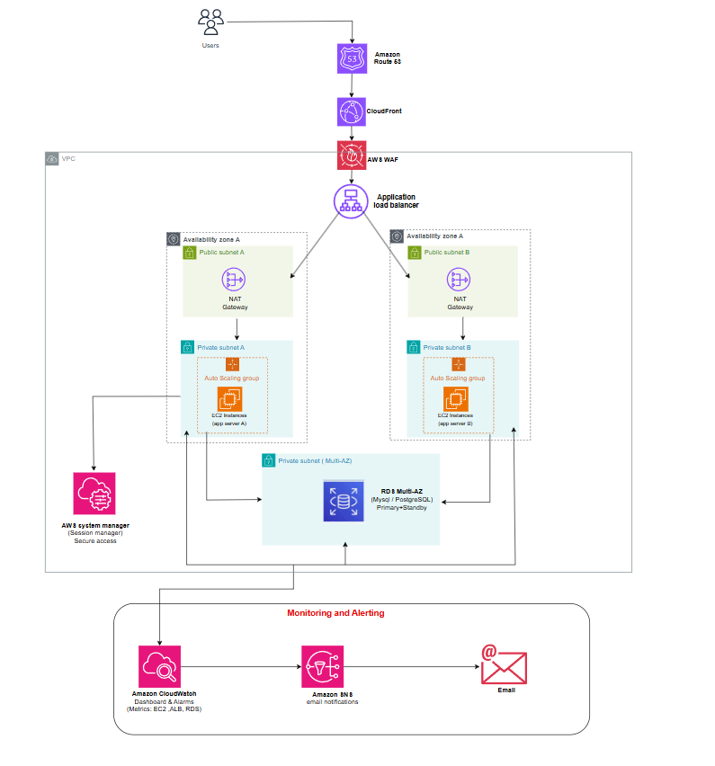

# AWS Scalable Web Application Infrastructure on AWS using Terraform

## Project Overview

This project provisions a highly available, scalable, and secure web application infrastructure on AWS using Terraform.

The infrastructure follows AWS Well-Architected Framework principles and implements:

- Multi-AZ deployment for high availability
- Auto Scaling for elasticity
- Application Load Balancer for traffic distribution
- Amazon RDS Multi-AZ for database resilience
- Amazon Route 53 for DNS management
- Amazon CloudFront for content delivery
- AWS WAF for application security
- AWS Systems Manager for secure instance management
- Amazon CloudWatch for monitoring
- Amazon SNS for alerting and notifications
- Remote Terraform State Management using Amazon S3

---

# Architecture Diagram



---

# Architecture Description

This architecture is designed to host a production-ready web application in a highly available and fault-tolerant environment.

The request flow is illustrated below:

```text
Users
   │
   ▼
Amazon Route 53
   │
   ▼
Amazon CloudFront
   │
   ▼
AWS WAF
   │
   ▼
Application Load Balancer
   │
   ▼
Auto Scaling Group
 ├── EC2 Instance (AZ-A)
 └── EC2 Instance (AZ-B)
   │
   ▼
Amazon RDS Multi-AZ

Monitoring:
CloudWatch → SNS → Email Notifications

Management:
Systems Manager → EC2 Instances
```

---

# Infrastructure Components

## 1. Amazon VPC

The Virtual Private Cloud (VPC) provides network isolation for all AWS resources.

### Configuration

| Component | Details |
|------------|----------|
| CIDR Block | 10.0.0.0/16 |
| Availability Zones | 2 |
| Public Subnets | 2 |
| Private Application Subnets | 2 |
| Private Database Subnets | 1 Multi-AZ |
| Internet Gateway | Enabled |
| NAT Gateways | 2 |

### Purpose

The VPC separates public-facing resources from backend services and databases while maintaining secure inter-service communication.

---

## 2. Amazon Route 53

Amazon Route 53 acts as the DNS service for the application.

### Responsibilities

- Domain name management
- DNS resolution
- Traffic routing
- Health checks
- Alias records

### Workflow

```text
Client Request
      │
      ▼
Amazon Route 53
      │
      ▼
CloudFront Distribution
```

---

## 3. Amazon CloudFront

Amazon CloudFront serves as the Content Delivery Network (CDN).

### Benefits

- Reduced latency
- Global edge locations
- HTTPS support
- Static content caching
- Improved application performance

### Purpose

CloudFront accelerates content delivery to users worldwide while reducing the load on the backend infrastructure.

---

## 4. AWS WAF

AWS Web Application Firewall protects the application against common web attacks.

### Security Controls

- SQL Injection Protection
- Cross-Site Scripting (XSS) Protection
- OWASP Top 10 Mitigation
- Bad Input Detection
- Request Filtering

### Purpose

WAF serves as the first security layer before requests reach the application.

---

## 5. Application Load Balancer (ALB)

The Application Load Balancer distributes incoming traffic across application servers deployed in multiple Availability Zones.

### Features

- Layer 7 Load Balancing
- Health Checks
- SSL/TLS Termination
- Path-Based Routing
- Host-Based Routing

### Benefits

- High availability
- Automatic failover
- Improved performance

---

## 6. NAT Gateways

Each Availability Zone contains a dedicated NAT Gateway.

### Purpose

Allows resources within private subnets to access the Internet while preventing direct inbound access.

### Benefits

- Enhanced security
- High availability
- AWS recommended architecture

---

## 7. Auto Scaling Group (ASG)

The Auto Scaling Group automatically adjusts the number of EC2 instances based on application demand.

### Configuration

```text
Minimum Capacity : 2
Desired Capacity : 2
Maximum Capacity : 6
```

### Scaling Metrics

- CPU Utilization
- Request Count
- Load Balancer Metrics

### Benefits

- Cost optimization
- High availability
- Automatic resource provisioning

---

## 8. Amazon EC2 Instances

The application runs on EC2 instances deployed across two Availability Zones.

### Deployment Strategy

| Availability Zone | Resources |
|------------------|------------|
| AZ-A | App Server A |
| AZ-B | App Server B |

### Security

- Private Subnets
- Security Groups
- IAM Roles
- Systems Manager Access
- No Public IP Addresses

---

## 9. Amazon RDS Multi-AZ

Amazon RDS hosts the application database.

### Configuration

```text
Engine: MySQL / PostgreSQL
Deployment: Multi-AZ
Backup: Enabled
Storage: Encrypted
```

### Features

- Automatic Failover
- Automated Backups
- Database Patching
- Multi-AZ Replication

### Benefits

- High availability
- Data durability
- Managed operations

---

## 10. AWS Systems Manager

AWS Systems Manager provides secure management of EC2 instances without requiring SSH access.

### Features

- Session Manager
- Run Command
- Patch Management
- Parameter Store
- Automation

### Benefits

- No Bastion Host
- No Open SSH Port
- Improved Security

---

## 11. Amazon CloudWatch

Amazon CloudWatch collects and monitors metrics, logs, and events across the infrastructure.

### Monitored Resources

- EC2 Instances
- Auto Scaling Groups
- Application Load Balancer
- Amazon RDS
- AWS WAF

### Dashboards

Custom dashboards provide centralized visibility into infrastructure health and performance.

---

## 12. Amazon SNS

Amazon Simple Notification Service sends notifications when CloudWatch alarms are triggered.

### Notification Types

- Email Alerts
- Infrastructure Events
- Performance Warnings
- Availability Issues

### Alert Examples

- High CPU Utilization
- Instance Health Failure
- Database Performance Issues
- Security Alerts

---

# Monitoring and Alerting Flow

```text
Amazon CloudWatch
          │
          ▼
      Amazon SNS
          │
          ▼
    Email Notification
```

CloudWatch continuously monitors the infrastructure and triggers SNS notifications whenever predefined thresholds are exceeded.

---

# Terraform State Management

Terraform state is stored remotely in Amazon S3.

## Backend Configuration

```hcl
terraform {
  backend "s3" {
    bucket         = "terraform-state-prod"
    key            = "prod/terraform.tfstate"
    region         = "eu-west-3"
    encrypt        = true
    dynamodb_table = "terraform-locks"
  }
}
```

---

# S3 Backend Benefits

- Centralized terraform state
- Team collaboration
- State versioning
- Disaster recovery
- State encryption

---

# DynamoDB State Locking

A DynamoDB table is used for state locking.

### Purpose

- Prevent concurrent Terraform execution
- Avoid state corruption
- Enable safe team collaboration

---

# Project Structure

```text
.
├── backend.tf
├── provider.tf
├── variables.tf
├── outputs.tf
├── terraform.tfvars
│
├── vpc.tf
├── route53.tf
├── cloudfront.tf
├── waf.tf
├── alb.tf
├── ec2.tf
├── asg.tf
├── rds.tf
├── ssm.tf
├── cloudwatch.tf
├── sns.tf
│
├── README.md
│
└── images/
    └── architecture.png
```

---

# Deployment Steps

## Initialize Terraform

```bash
terraform init
```

## Validate Configuration

```bash
terraform validate
```

## Review Infrastructure Changes

```bash
terraform plan
```

## Deploy Infrastructure

```bash
terraform apply
```

## Destroy Infrastructure

```bash
terraform destroy
```

---

# Security Best Practices Implemented

✅ Multi-AZ Deployment

✅ Private Application Servers

✅ Private Database Layer

✅ AWS WAF Protection

✅ Systems Manager Administration

✅ Load Balancer Health Checks

✅ CloudWatch Monitoring

✅ SNS Notifications

✅ IAM Roles

✅ Security Groups

✅ Terraform State Encryption

✅ DynamoDB State Locking

---

# High Availability Strategy

The infrastructure eliminates single points of failure through:

- Multiple Availability Zones
- Redundant NAT Gateways
- Auto Scaling Group
- Application Load Balancer
- RDS Multi-AZ Deployment
- Distributed CloudFront Edge Network

This design ensures application continuity even in the event of an Availability Zone failure.

---

# Author

**Driss Ahdadouch**

AWS Infrastructure as Code (IaC) Project using Terraform
